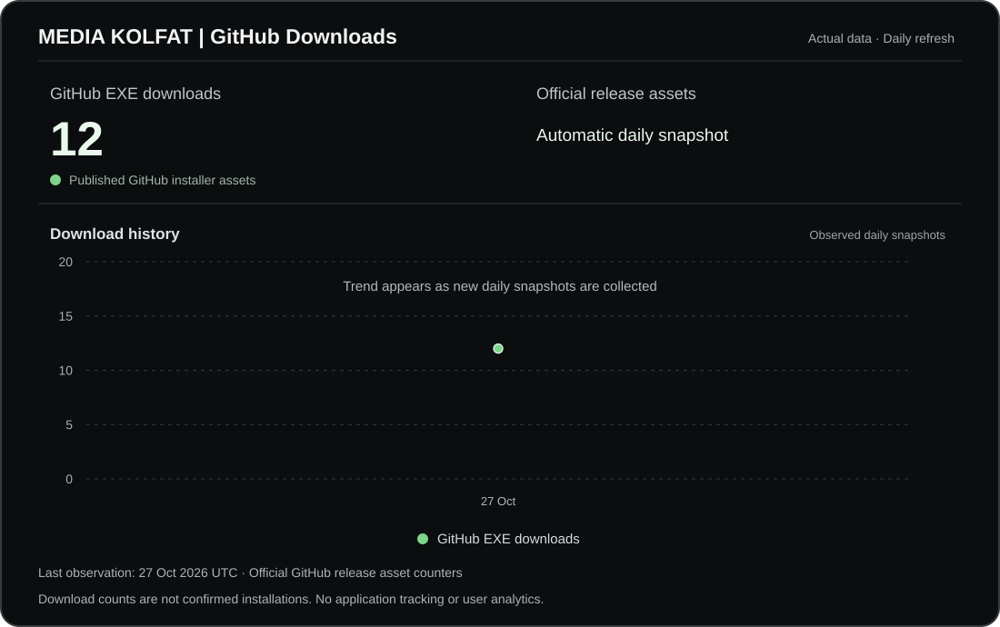

  

# MEDIA KOLFAT

**MEDIA KOLFAT takes care of your media.**

MEDIA KOLFAT is a desktop application for organizing and managing photo and video collections with a focus on practical, safe, predictable media organization and a dedicated dark interface. **Windows is the stable release platform; a Linux x64 Beta is being prepared separately.**

> **Official distribution:** The stable Windows edition is available through [Microsoft Store](https://apps.microsoft.com/detail/9p0x091t7mv4?ocid=webpdpshare) and [GitHub Releases](https://github.com/1n50mn14c933k/MEDIA_KOLFAT/releases/tag/v2.0.0). The separate Linux Beta will appear under [GitHub Releases](https://github.com/1n50mn14c933k/MEDIA_KOLFAT/releases) only after its assets and release checks are ready. Proprietary application source code is not published here.

## Status

**MEDIA KOLFAT is available on Microsoft Store and via a direct Windows EXE download on GitHub.** 🎉

**Current stable Windows release:** **2.0.0** (Microsoft Store package **2.0.0.0**, published October 27, 2026). See the [Windows v2.0.0 release](https://github.com/1n50mn14c933k/MEDIA_KOLFAT/releases/tag/v2.0.0) and [changelog](CHANGELOG.md).

**Linux x64:** A separate, explicitly labeled public Beta release is being prepared. It is **not published yet**. Guided COPY was tested with 101 sample photos on Ubuntu 26.04.1 LTS; MOVE remains disabled on Linux.

The current focus is maintaining the stable Windows application while validating the new Linux Beta. **macOS** remains a potential future platform.

## Official links

- 💻 Windows EXE: https://github.com/1n50mn14c933k/MEDIA_KOLFAT/releases/download/v2.0.0/MEDIA_KOLFAT_2.0.0_Setup.exe
- 🐧 Linux Beta: [GitHub Releases](https://github.com/1n50mn14c933k/MEDIA_KOLFAT/releases) (separate pre-release pending; no Linux download published yet)
- 🔎 SHA-256 checksum: https://github.com/1n50mn14c933k/MEDIA_KOLFAT/releases/download/v2.0.0/MEDIA_KOLFAT_2.0.0_SHA256.txt
- 🛍️ Microsoft Store: https://apps.microsoft.com/detail/9p0x091t7mv4?ocid=webpdpshare
- 🌐 Product website: https://kolfat.app/en/Media_Kolfat/
- 🏠 KOLFAT: https://kolfat.app/
- 𝕏 X: https://x.com/KOLFAT_APP
- ▶️ YouTube: https://www.youtube.com/@KOLFAT_APP
- 🎵 TikTok: https://www.tiktok.com/@kolfat.app
- 🛠️ Support: https://kolfat.app/support/
- 🐛 Bug reports: https://github.com/1n50mn14c933k/MEDIA_KOLFAT/issues
- 🗺️ Public roadmap: [ROADMAP.md](ROADMAP.md)
- 📋 Release notes: [MEDIA KOLFAT 2.0.0](https://github.com/1n50mn14c933k/MEDIA_KOLFAT/releases/latest)
- 🗂️ Public GitHub Pages: https://1n50mn14c933k.github.io/kolfat/Media_Kolfat/

## 🐧 Linux x64 Public Beta — preparation status

MEDIA KOLFAT 2.0 for Linux is undergoing final Beta validation. **The Linux release and download assets are not public yet.** When published, it will be a separate **GitHub Pre-release** in this repository, not part of the stable Windows v2.0.0 release.

- **Available in the tested Beta:** Guided COPY with source-file retention, date/EXIF-based organization, manual source selection, and duplicate detection.
- **Native desktop validation:** Ubuntu 26.04.1 LTS x64; a real Guided COPY operation completed with 101 sample photos and produced an operation report.
- **Linux limitation:** **MOVE is intentionally disabled**, including in Advanced Mode, until safe original-file deletion is demonstrably established.
- **Other limitations:** Some settings and Linux-specific user-interface functions remain under investigation. Compatibility across distributions and desktop environments is not guaranteed.
- **Future downloads:** Portable Linux x64 `.tar.gz`, Debian/Ubuntu x64 `.deb`, and SHA-256 checksums will be provided on the [GitHub Releases page](https://github.com/1n50mn14c933k/MEDIA_KOLFAT/releases) after release validation.

This is experimental software. Keep independent backups of irreplaceable photos and videos and report reproducible defects in [GitHub Issues](https://github.com/1n50mn14c933k/MEDIA_KOLFAT/issues). Never report personal file paths, private media, or secrets publicly.

See the [prepared Linux Beta release notes](docs/LINUX_BETA_RELEASE_NOTES_DRAFT.md).

## 🔐 Official Windows distribution

MEDIA KOLFAT offers **two official download channels**:

- **Microsoft Store:** [Install or update](https://apps.microsoft.com/detail/9p0x091t7mv4?ocid=webpdpshare), with Microsoft Store-managed updates.
- **GitHub Releases:** [Download the Windows x64 EXE installer](https://github.com/1n50mn14c933k/MEDIA_KOLFAT/releases/download/v2.0.0/MEDIA_KOLFAT_2.0.0_Setup.exe), with the accompanying [SHA-256 checksum](https://github.com/1n50mn14c933k/MEDIA_KOLFAT/releases/download/v2.0.0/MEDIA_KOLFAT_2.0.0_SHA256.txt).

The GitHub installer is currently **unsigned**, so Windows may show an unknown-publisher or SmartScreen warning. Do not disable Windows security protections. The EXE version does not receive Microsoft Store updates; obtain its later releases from official GitHub Releases.

The proprietary application source stays private. Always keep independent backups of irreplaceable media.

## What is MEDIA KOLFAT?

Large photo and video collections can become difficult to manage when files come from different cameras, phones, folders and years.

MEDIA KOLFAT is designed to make those libraries easier to understand and organize by combining media discovery, metadata handling, previews and structured organization workflows in one Windows application.

## Core capabilities

### What's available in version 2.0.0

- 🧭 **Guided and Advanced experiences** for different user needs
- 📁 **Media Folder Browser** and automatic computer scanning for photo and video discovery
- 🔎 **Duplicate Finder** for identifying duplicate media
- 🖼️ **Browse Library** with improved layout, previews and thumbnail fallback handling
- 📊 **Library Overview** with media, health, duplicate and organization information
- 🩺 **Photos Health Check** and metadata/date handling, including media without usable EXIF dates
- 📅 **Organize by Date** for predictable file organization
- 📋 **COPY and MOVE modes** with automatic operation reports; use COPY when originals should remain in place and select MOVE intentionally when transferring originals
- 🕘 **Activity History** for completed scans and organization operations
- 🔄 **Manual photo rotation**, including multi-select, batch rotation, Rotate Left, Rotate Right, 180°, and batch Undo in Browse Library
- 🔐 **Privacy & Local Processing** information inside the app
- 🌍 **English, Persian (Farsi), German and Spanish** language support, including Persian right-to-left (RTL) presentation
- 🌑 Dedicated dark interface and stability, safety and performance improvements
- ⏯️ **Pause, Resume and Cancel** controls with improved handling of interrupted operations
- 📊 **Detailed organization progress**, including the current file, processing stage, completed items and percentage
- 👁️ **Improved organized-file visibility**, including hidden and system attribute handling on network drives
- 🛡️ **Additional MOVE safeguards** to help protect original files
- ✨ Improved activity indicator, **Select All Visible** selection and error handling
- 🗂️ **File Type Selection** with extension counts and optional Other Files
- 📁 **Seven conditional destination categories**, created only when needed
- 🌐 **Improved SMB/NAS-to-NAS MOVE** behavior
- 🔗 **Safer symbolic-link handling**

MEDIA KOLFAT is focused on Windows. The application's normal photo and video management workflow is designed for local processing, without requiring the media library to be uploaded to KOLFAT servers.

**Important when organizing files:** COPY and MOVE have different consequences for source files. Review the selected mode and destination carefully, and keep an independent backup of irreplaceable media.

See the [official version 2.0.0 release](https://github.com/1n50mn14c933k/MEDIA_KOLFAT/releases/latest) for published release highlights.

## Why choose MEDIA KOLFAT?

MEDIA KOLFAT is designed for users who primarily want to **organize, inspect and clean up their photo and video collections** without paying for a professional editing suite they may never need.

The products below are all capable applications, but they serve somewhat different audiences. This comparison is intended to make those differences clear rather than suggest that one product is the right choice for every user.

| Feature | **MEDIA KOLFAT FREE** | Adobe Lightroom / Classic | ACDSee Photo Studio Home | Mylio Photos+ | ON1 Photo RAW |
|---|---|---|---|---|---|
| **Core pricing model** | ✅ **FREE** | 💰 Subscription | 💰 Paid license / subscription | ◐ Free app available; Photos+ is paid | 💰 Paid license / subscription |
| **Free core edition** | ✅ **Yes — remains free** | ❌ | ❌ | ✅ Free Mylio Photos app available | ❌ |
| **Windows desktop** | ✅ | ✅ | ✅ | ✅ | ✅ |
| **macOS support** | ❌ | ✅ | ❌ Home edition is Windows-focused | ✅ | ✅ |
| **iOS / Android ecosystem** | ❌ | ✅ | ◐ Mobile Sync ecosystem | ✅ | ✅ |
| **Local-first media management** | ✅ **Core design** | ◐ Lightroom Classic supports local files; Lightroom also offers cloud-centric workflows | ✅ | ✅ **Core design** | ✅ |
| **Cloud required for core workflow** | ✅ **No** | ◐ Depends on Lightroom workflow/product | ✅ No | ✅ No | ✅ No |
| **Photo + video library** | ✅ | ✅ | ✅ | ✅ | ◐ Primarily photography-focused |
| **Metadata / EXIF handling** | ✅ | ✅ | ✅ | ✅ | ✅ |
| **Date-based physical folder organization** | ✅ **Core focus** | ✅ Lightroom Classic supports local folder organization | ✅ | ◐ Preserves and works with existing folder structures | ✅ Folder-based browsing |
| **Duplicate Finder** | ✅ | ◐ Duplicate Detection available in Lightroom on the web | ✅ | ✅ | — |
| **Photos Health Check** | ✅ **Dedicated workflow** | — | — | — | — |
| **Manual photo rotation** | ✅ Left, right, 180° and batch Undo | ◐ Rotation/editing tools | ◐ Rotation/editing tools | ◐ Rotation/editing tools | ◐ Rotation/editing tools |
| **Large-library browsing** | ✅ | ✅ | ✅ | ✅ | ✅ |
| **RAW development** | ❌ | ✅ **Advanced** | ◐ RAW viewing/decoding in Home | ◐ Essential RAW editing | ✅ **Advanced** |
| **Advanced photo editing** | ❌ | ✅ | ✅ | ◐ Essential editing tools | ✅ |
| **Layers / compositing** | ❌ | ❌ Lightroom itself | ❌ Home edition | ❌ | ✅ |
| **AI-assisted organization / search** | ❌ | ✅ | ✅ | ✅ | ✅ AI keywording |
| **Face recognition** | ❌ | ✅ | ✅ | ✅ | — |
| **Cross-device sync** | ❌ | ✅ | ◐ Mobile Sync ecosystem | ✅ **Strong focus** | ✅ With Cloud Sync options |
| **Simple guided organization workflow** | ✅ **Core design** | ◐ Professional / feature-rich workflow | ◐ Feature-rich DAM workflow | ◐ Library and device-sync workflow | ◐ Professional photography workflow |

**Legend:** ✅ Included · ◐ Available, partial, optional, or implemented differently · ❌ Not included · — No directly equivalent primary feature identified in the referenced product documentation

### The difference in one sentence

> **MEDIA KOLFAT is not trying to replace Lightroom or a professional RAW editor.**
>
> It is built for users who want to **organize, inspect and clean up their photo and video collection without paying for an editing suite they may never use.**
>
> **MEDIA KOLFAT FREE stays FREE.**
>
> Need professional RAW editing, AI-assisted search, cloud synchronization or mobile apps? Another product may be a better fit.
>
> Need a straightforward, local-first Windows tool focused on taking care of your media? That is what **MEDIA KOLFAT** is built for.

### Comparison notes

Competitor capabilities and commercial models can change over time. The table is based on publicly documented product information available at the time of writing and is intended as a practical feature overview, not a claim that the products are identical in scope.

Official references:

- Adobe Lightroom: https://www.adobe.com/products/photoshop-lightroom.html
- Adobe Duplicate Detection: https://helpx.adobe.com/lightroom/web/share-your-work/review-and-download/duplicate-detection.html
- ACDSee Photo Studio Home: https://www.acdsee.com/en/products/photo-studio-home/features/
- Mylio Photos: https://mylio.com/
- Mylio Photo DeDupe: https://support.mylio.com/find-duplicate-photos-photo-dedupe
- ON1 Photo RAW: https://www.on1.com/products/photo-raw/features/

## MEDIA KOLFAT editions

### MEDIA KOLFAT

The core edition is available free of charge and provides the essential media organization experience.

### MEDIA KOLFAT PRO

MEDIA KOLFAT PRO is planned as an optional paid edition/add-on for additional advanced functionality over time.

Future PRO functionality will be announced only when it is ready to be publicly committed to. The public roadmap is not a contractual promise of specific future features or release dates.

## System requirements

MEDIA KOLFAT is built for 64-bit Windows desktop systems and is available through Microsoft Store and official GitHub Releases.

Check the Microsoft Store listing for Store requirements and the GitHub release for standalone Windows x64 distribution.

Storage requirements depend on the size of the user's library and generated application data such as thumbnails and cache files.

## Privacy

MEDIA KOLFAT is designed around local media organization. The current core workflow processes the user's photo and video library on the user's Windows device rather than requiring the library to be uploaded to KOLFAT servers.

For complete and authoritative privacy information, see:

- Privacy Policy: https://kolfat.app/privacy/

If future cloud, online or AI-backed functionality changes how data is processed, the relevant product information and privacy documentation will be updated before that functionality is released.

## Installation and downloads

Download only from official channels, not third-party mirrors. Windows stable and Linux Beta are separate release tracks.

- **GitHub Windows EXE:** [Installer](https://github.com/1n50mn14c933k/MEDIA_KOLFAT/releases/download/v2.0.0/MEDIA_KOLFAT_2.0.0_Setup.exe) and [SHA-256 checksum](https://github.com/1n50mn14c933k/MEDIA_KOLFAT/releases/download/v2.0.0/MEDIA_KOLFAT_2.0.0_SHA256.txt)
- **Microsoft Store:** [Official listing](https://apps.microsoft.com/detail/9p0x091t7mv4?ocid=webpdpshare)
- **Linux x64 Beta:** [GitHub Releases](https://github.com/1n50mn14c933k/MEDIA_KOLFAT/releases) (pending publication; no direct Linux download link yet)

The Store edition receives Store-managed updates; the GitHub EXE edition does not. GitHub-generated source archives are not Windows installers.

## What this repository is for

This is the public home of MEDIA KOLFAT on GitHub. Use it to:

- ⭐ Star the project
- 👁️ Watch for project and release updates
- 🐛 Report reproducible bugs
- 💡 Suggest features and improvements
- 📋 Read the public roadmap
- 📦 Read release notes and version history
- 🔐 Follow the private security-reporting process

## What this repository does not contain

For security and intellectual-property protection, this repository does **not** contain:

- MEDIA KOLFAT application source code
- Internal build or signing pipelines
- Code-signing certificates or keys
- Credentials or secrets
- Private development plans

The proprietary application source is maintained separately in a private repository.

## Reporting bugs

Before opening an issue, please check existing issues to avoid duplicates.

For bug reports, include:

- MEDIA KOLFAT version
- Operating system and version (Windows or Linux; include desktop environment for Linux)
- Steps to reproduce
- Expected behavior
- Actual behavior
- Relevant sanitized logs or screenshots

Remove personal information, private file paths, credentials and sensitive media before posting publicly.

Do **not** publish suspected security vulnerabilities in public Issues. See [SECURITY.md](SECURITY.md).

## Releases and version history

MEDIA KOLFAT is publicly available through Microsoft Store and official GitHub Releases.

Current **stable Windows release**: **2.0.0** (Store package **2.0.0.0**). Linux will have a separate pre-release. Release notes and version history are tracked through [GitHub Releases](https://github.com/1n50mn14c933k/MEDIA_KOLFAT/releases) and [CHANGELOG.md](CHANGELOG.md).

## Roadmap

See [ROADMAP.md](ROADMAP.md).

## Support

- Support website: https://kolfat.app/support/
- GitHub support guidance: [SUPPORT.md](SUPPORT.md)

## Legal

The authoritative KOLFAT legal pages are:

- Privacy Policy: https://kolfat.app/privacy/
- Terms of Use: https://kolfat.app/terms/
- Disclaimer: https://kolfat.app/disclaimer/
- Third-Party Licenses: https://kolfat.app/licenses/
- Support: https://kolfat.app/support/

## License and source availability

MEDIA KOLFAT is proprietary software.

This public repository is provided for product information, community interaction, support coordination and release transparency. No open-source license is granted for the MEDIA KOLFAT application source code.

See [LICENSE.md](LICENSE.md) for the repository's proprietary rights notice and [CONTRIBUTING.md](CONTRIBUTING.md) for the forms of public contribution accepted here.

## 📊 MEDIA KOLFAT | GitHub Downloads Dashboard

**GitHub EXE downloads** are counted automatically from official GitHub Release installer assets. These figures represent downloads, **not confirmed installations**. No in-app telemetry or personal information is collected for this dashboard.

[Download MEDIA KOLFAT 2.0.0](https://github.com/1n50mn14c933k/MEDIA_KOLFAT/releases/tag/v2.0.0) · [How dashboard statistics work](docs/DOWNLOAD_DASHBOARD.md)

---

© 2026 KOLFAT · MEDIA KOLFAT
